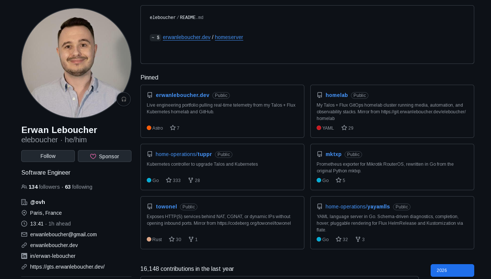
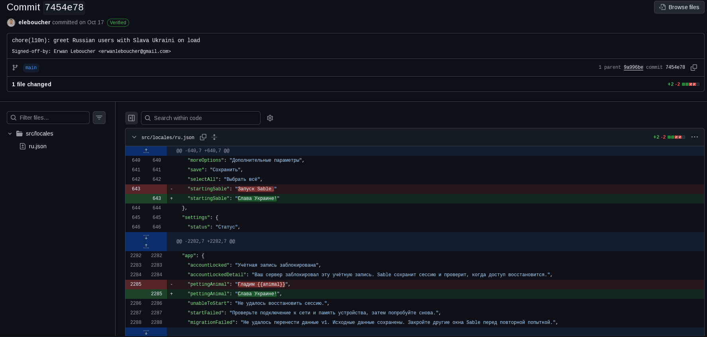
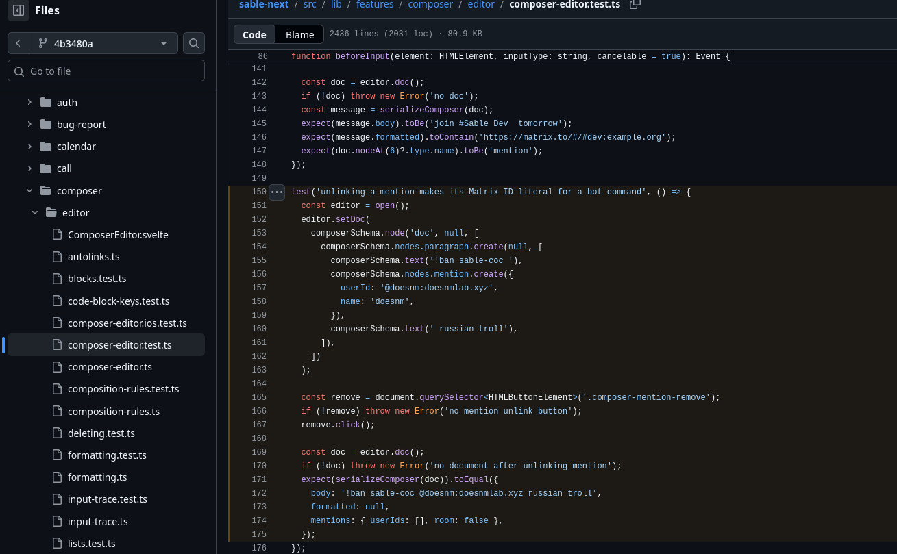
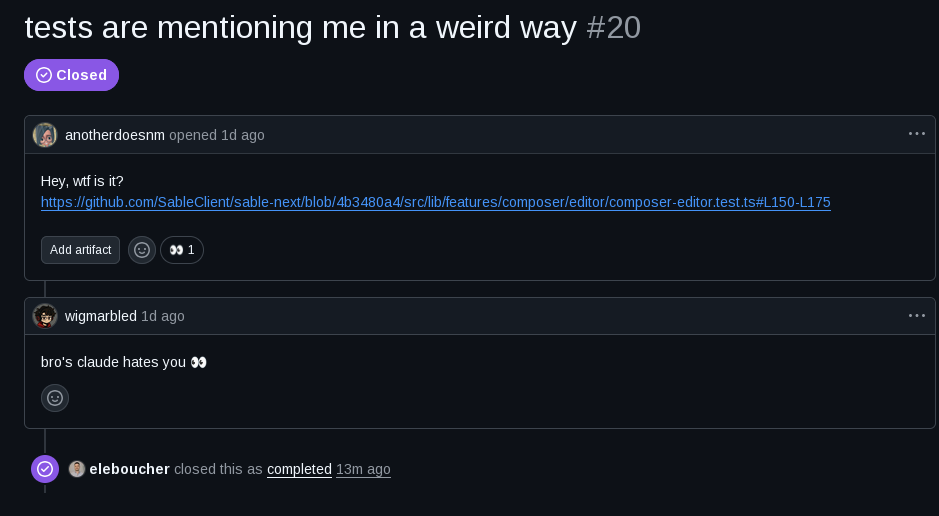
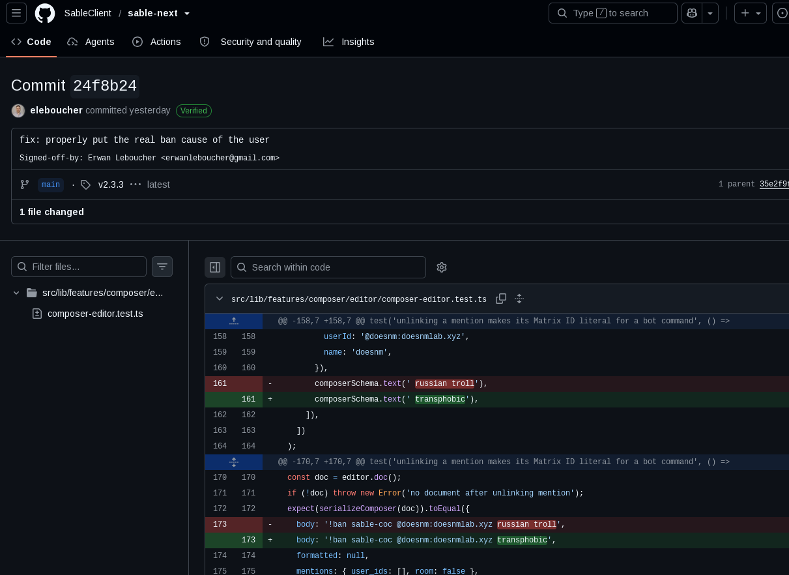
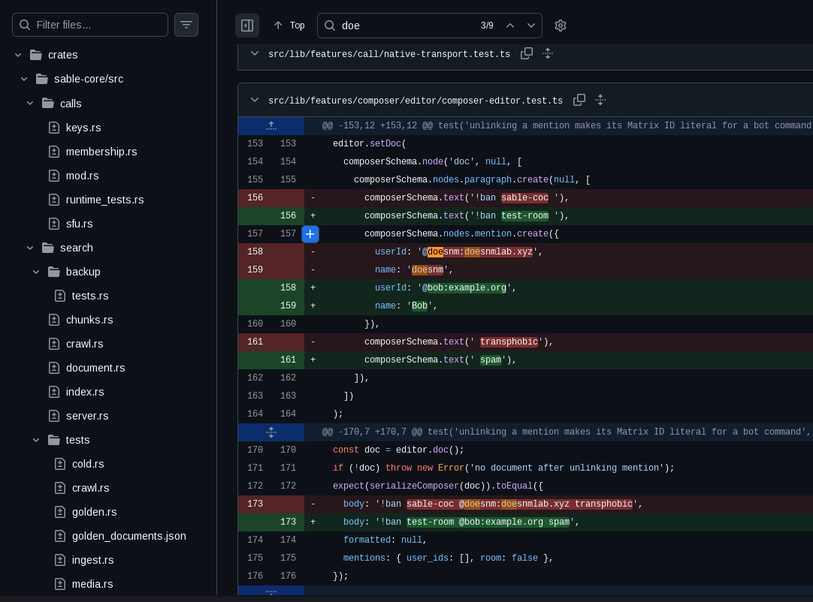
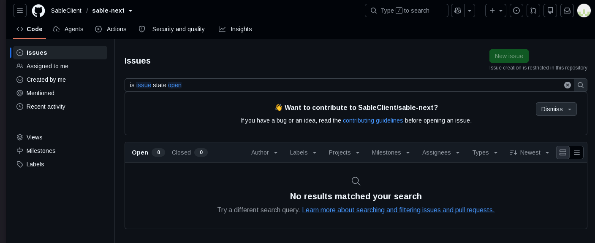

# sable-next developer questionable actions dubious slogans, racism and other questionable behavior.

tl;dr: erwan (one of sable developers) is russophobic

## Who is who

1. **Erwan (Erwan Leboucher)** `@genesixx:erwanleboucher.dev` - the maintainer.
2. **doesnm** `@doesnm:doesnmlab.xyz` - Matrix user, supported Sable, Sable ex-user.
3. **mini_bomba** `@mini_bomba:minibomba.pro` - Bystander
4. **girlinred (Amo)** `@girlinred:doyoulistentogirlinred.gay` - Bystander
5. **rustyraven** `@rustyraven:extera.xyz` - Banned 8 Oct
6. **F0rest (Daisy)** `@sysadmin:deep.f0rest.net` - Suggested that one loading screen change
7. **Meowlnir** `@meowlnir:sable.moe` - Sable's moderation bot

Calling Erwan Leboucher just "one of the maintainers" is dishonest. He is top-1 contributor to sable-next repo with ~6k commits.

---

> "i just cannot accept until ukrainian is fully translated"

**Erwan** (`@genesixx:erwanleboucher.dev`), 17 Oct, [10:01:09](https://matrix.to/#/#dev:sable.moe/$3BWPvubpdktANu2BApnNInN3flVGPb30_5iGkk8WsxU?via=sable.moe)

Your policy of holding a locale hostage in favour of another one is at least utterly idiotic. It's Erwan's personal "preference", it's not "won't add until reviewed" or "deprioritised"

---

> "chore(l10n): greet Russian users with Slava Ukraini on load"

Commit [`7454e78`](https://github.com/SableClient/sable-next/commit/7454e78532d67aef9cf783fb9bca5799e2b7c925), 17 October 2026, 15:36 UTC, signed off by **Erwan Leboucher** (`@genesixx:erwanleboucher.dev`).
> **9:58 ・ Erwan** `@genesixx:erwanleboucher.dev` [i don't want to accept russian language :D](https://matrix.to/#/!6DYBIzUfDoKmqk53wyRqcod2G7LTcR9fEm9XBfaenNI/$mR70SL4qnYDK3uid044B2uBovZQkGaMsOCHlUSYdQ8A?via=sable.moe&via=matrix.org&via=unredacted.org)
>
> **10:04 · F0rest** `@sysadmin:deep.f0rest.net`
> [Delta: @Erwan if language is russian set the loading screen tip to Slava Ukraini :3](https://matrix.to/#/#dev:sable.moe/$per7tOInZTt1kUChAIKh1LNf3vP9JmuiO_gmSHiT8C4?via=sable.moe)
>
> **10:04 · F0rest** `@sysadmin:deep.f0rest.net`
> [Delta: good middle ground?](https://matrix.to/#/#dev:sable.moe/$ZMCUmUtR6c906eNs5fYrkM448IR8CkY_Qk4YI4Wv4-E?via=sable.moe)
>
> **10:04 · Erwan** `@genesixx:erwanleboucher.dev`
> [this](https://matrix.to/#/#dev:sable.moe/$du5ZbEB-54ww9SEWYprvpN69cE2uAGjsBYUvsiyVvdE?via=sable.moe)

"Good middle ground" to accept a language instead of following dumb policy described above.

Let me be precise about "greet on load": it's a hijacked loading string, not a banner/dialog you can dismiss. You have to look at that line during whole sync process.

Here is the diff:

| Before | After |
|---|---|
| `"startingSable": "Запуск Sable…"` | `"startingSable": "Слава Украине!"` |
| `"pettingAnimal": "Гладим {{animal}}"` | `"pettingAnimal": "Слава Украине!"` |

"pettingAnimal" is an easter-egg syncing label.

Your UI would say "Glory to Ukraine", if system/browser language is set to Russian. A dialog or banner could have been enough, you already have an Ukraine flag in about section! It's an intentional sabotage of Russian translation, absolutely unnecessary to show your political position. Remember that it's a "middle ground" to accept Russian translation. I can't even think of possible reasoning behind this decision, it's just provocative, as it targets anyone who reads Russian (read next section on this).

These strings are in `main` - [line 643](https://github.com/SableClient/sable-next/blob/main/src/locales/ru.json#L643) and [line 2265](https://github.com/SableClient/sable-next/blob/main/src/locales/ru.json#L2265), last checked the 6th of November, 2026.

Looks like someone decided to hide that, don’t worry we have all need proof. You can open file (https://github.com/zozol-tech/sable-next-developer-description/blob/main/sable%20chore(l10n)_%20greet%20Russian%20users%20with%20Slava%20Ukraini%20on%20load%20%C2%B7%20SableClient_sable-next%407454e78%20%C2%B7%20GitHub%20(02.11.2026%2019_04_09).u.zip.html)
Commit 7454e78

or check fork here https://github.com/zozol-tech/sable-next-fix/commit/7454e78


---

you could write anything there, like a wish for peace, but you only had the mind to do that.
honestly a pathetic spectacle.

> It's about the government, not the people

**This is a lame, horrible, weak, awful and pathetic attempt to defend such decision.**

Locale strings show up depending on system language, not donation/citizenship/opinion/etc. You targeted anyone who reads Russian, not only those who support Russia. People living in CIS countries speak Russian, some Ukrainians, Belarusians, Kazakhs speak Russian, relocants speak Russian too.

> **10:01 · owlbot** `@owlbot:enigmatics.org`
> [there are also ukrainian nationals that speak russian but no ukrainian, i think not an insignificant amount](https://matrix.to/#/#dev:sable.moe/$I9iI_N3606AFl0L0psGmMWe19ntazxupt7t3MOPoMpI?via=sable.moe)
>
> **10:02 · mini_bomba** `@mini_bomba:minibomba.pro`
> [there are also people who prefer to use software in english rather than their native language](https://matrix.to/#/#dev:sable.moe/$8RFNfoMWXgjxMEhdeMcCBtCE9da8cbfQ29Bl8yFt3p0?via=sable.moe)
>
> **11:15 · girlinred** `@girlinred:doyoulistentogirlinred.gay`
> [Amo: Can help with Ukrainian and make russian translation if needed (tho not fan myself, but people speaking russian not only who are from russia or support russia)](https://matrix.to/#/#dev:sable.moe/$bgj6PS7gdbGrJmtmizrOCbr7cUrS6b-fTEWtRHJuKTQ?via=sable.moe)

Three people explained why such decision is horrible, but Erwan committed that anyway. Well done!

---

**doesnm** (`@doesnm:doesnmlab.xyz`) - user who donated to Sable, he has a signed Donor award in his profile. The 27th of September he mentions that iPhones are still sold in Russia, and here is the conversation which happens after:

> **18:49:37 · Erwan** `@genesixx:erwanleboucher.dev`
> [well you don't have them in your country](https://matrix.to/#/#dev:sable.moe/$yCdCm3SrRZiLVNof6d07OndYCUWLt-jAJu-1gD0w9ic?via=sable.moe)
>
> **18:50:24 · doesnm** `@doesnm:doesnmlab.xyz`
> [nah they are still sold](https://matrix.to/#/#dev:sable.moe/$FKwWDb1jdcvReyTMRnuNg4N4xftFRESTqwhVwazuk80?via=sable.moe)
>
> **18:50:39 · Erwan** `@genesixx:erwanleboucher.dev`
> [sanction doesn't work](https://matrix.to/#/#dev:sable.moe/$upCBR2adwzBvKRe7SAoFfXU2QCwol5EV_cv7s-wtCCA?via=sable.moe)
>
> **18:50:51 · Erwan** `@genesixx:erwanleboucher.dev`
> [we should make them even worse](https://matrix.to/#/#dev:sable.moe/$m0kAZvroNOQZFusRoCKb-HYwKaFEaTDbNwjsDwQdEwQ?via=sable.moe)
>
> **18:51:05 · doesnm** `@doesnm:doesnmlab.xyz`
> [i hope it's /s lol](https://matrix.to/#/#dev:sable.moe/$PYGkoipnlV3e-MZ9riKvcRbmFTal34q_ag98VfIunHQ?via=sable.moe)
>
> **18:51:33 · Erwan** `@genesixx:erwanleboucher.dev`
> [no it's not](https://matrix.to/#/#dev:sable.moe/$o9hZzk4SQaYXZFKK6fOmSy7B7-ECrhGrkbSSTV8P8zI?via=sable.moe)
>
> **18:52:03 · doesnm** `@doesnm:doesnmlab.xyz`
> [okay then i don't want to continue](https://matrix.to/#/#dev:sable.moe/$xFowFEWRV2aFvCUijYlCsGp94Jny0OWJ-OK1YeReafQ?via=sable.moe)
>
> **18:52:16 · Erwan** `@genesixx:erwanleboucher.dev`
> [stop invading country :D](https://matrix.to/#/#dev:sable.moe/$819vLPBI8APaid87bBJES4tWSB2va9_dVvjirVv9rqM?via=sable.moe)
>
> **18:53:40 · doesnm** `@doesnm:doesnmlab.xyz`
> [are you provoking me?](https://matrix.to/#/#dev:sable.moe/$zEmQjDFqmnksBbfGUkywwuSEhXCoVuqD2s5frdZA1KM?via=sable.moe)
>
> **18:55:07 · Erwan** `@genesixx:erwanleboucher.dev`
> [what you will invade me too ?](https://matrix.to/#/#dev:sable.moe/$DuabSdawlWCbV4rf-0v16_chbEaVgvaUD_v57NsqL00?via=sable.moe)
>
> **18:58:19 · doesnm** `@doesnm:doesnmlab.xyz`
> [\*crickets\*](https://matrix.to/#/#dev:sable.moe/$ct-M9uDXiK4HLS4rXtOdoc6wzmKZQD84t1hUcY8CgLg?via=sable.moe)

22 minutes later (19:20), `@meowlnir:sable.moe` (moderation bot) sends this membership event:

```json
{"type": "m.room.member",
 "target": "@doesnm:doesnmlab.xyz",
 "content": {"membership": "ban", "reason": "Russian troll"}}
```

And then, one minute after the ban, in public:

> **19:21:10 · Erwan** `@genesixx:erwanleboucher.dev`
> [finally you noticed](https://matrix.to/#/#dev:sable.moe/$4QMQXhSo9hfiJEiXOSZ1FREZTRoaoPnHkp_uglLtmoc?via=sable.moe)
>
> **19:21:16 · Erwan** `@genesixx:erwanleboucher.dev`
> [i hope it will make jade happy :3](https://matrix.to/#/#dev:sable.moe/$toH6j1vs1SQ996sMrY6kHCHClWh4ctbHzCR_X84JifM?via=sable.moe)

Erwan, the war topic was opened from your side, completely on your initiative. YOU were the one who brought up politics and sanctions. No trolling happened. Summary: Erwan provokes doesnm by bringing up politics, gets pissed off and bans doesnm because he doesn't want to continue that topic Erwan brought up.

It was later pointed out by `@rustyraven:extera.xyz`, other people noticed and `@doesnm:doesnmlab.xyz` was unbanned after community backlash.

**And now the most unhinged and unreasonable thing**: Erwan didn't have enough to ban doesnm. Guess what has he done? He created a test fixture, which tests message composer mention unlinking, with following message: `!ban sable-coc @doesnm:doesnmlab.xyz russian troll`. You REALLY have to be dedicated, vindictive, petty to commit such unreasonable stuff. *You could put anything there. It didn't even have to be a real Matrix ID.*


Of course, this didn't go unnoticed, and [an issue calling that out was made](https://web.archive.org/web/20261103124433/https://github.com/SableClient/sable-next/issues/20).



**What happens later?**
1. Erwan replaces "russian troll" to "transphobic", stating it's "the real reason": [commit link](https://web.archive.org/web/20261104135927/https://github.com/SableClient/sable-next/commit/24f8b246877565142c4b23dca9c755d891025063). You contradict yourself! The reason was "russian troll", not "transphobic".
 

then change again

3. Erwan removes real users from tests (including himself @erwan:localhost). A mass cleaning. file https://github.com/zozol-tech/sable-next-developer-description/blob/main/sable%20test_%20remove%20real%20users%20from%20tests%20%C2%B7%20SableClient_sable-next%4098d672c%20(04.11.2026%2017_51_22).u.zip.html

4. Issue 20 gets deleted, PRs & issues disabled, hence the Wayback Machine link.

You can take a look on how the test fixture looked like: https://web.archive.org/web/20261103125007/https://github.com/SableClient/sable-next/blob/4b3480a4/src/lib/features/composer/editor/composer-editor.test.ts#L150-L175


---

> "i'm just tired of this victimization behavior"

(c) **Erwan** (`@genesixx:erwanleboucher.dev`), 28 Sep, [07:38:09](https://matrix.to/#/#dev:sable.moe/$vX7YTehQV6tjKFN5ESukwoSHstDC5qpgS-xdcQdV6o8?via=sable.moe).

Erwan, you were the one and only one, who steered the conversation into politics and war topic, and you were the one who banned person because he didn't want to engage in such conversation.

[rustyraven told he is not involved in the military conflict](https://matrix.to/#/!6DYBIzUfDoKmqk53wyRqcod2G7LTcR9fEm9XBfaenNI/$YyPNcLOc_QIc7ykyuWWdxG5HkpO-RJ7UgZv9w8AfOc4?via=sable.moe&via=matrix.org&via=unredacted.org), probably as most of Russian citizens.

> **07:37:09 · Erwan** `@genesixx:erwanleboucher.dev`
> [then be sorry about it don't act like we are the bad guy for doing sanction go in the street idk](https://matrix.to/#/#dev:sable.moe/$RlSZTnNlohxJ36nktPVhQFwR5lQ_A7_ErZFZTLbPPaw?via=sable.moe)
>
> **07:37:51 · mini_bomba** `@mini_bomba:minibomba.pro`
> [brother, you were the one who steered the convo onto the topic of the war, and then banned the person for not wanting to talk about it](https://matrix.to/#/#dev:sable.moe/$HU2j8TpVnmXOWGXzBQ1R_gZ1NeByeWOhDAOBqw7PPxo?via=sable.moe)
>
> **07:38:09 · Erwan** `@genesixx:erwanleboucher.dev`
> [i'm just tired of this victimization behavior](https://matrix.to/#/#dev:sable.moe/$vX7YTehQV6tjKFN5ESukwoSHstDC5qpgS-xdcQdV6o8?via=sable.moe)
>
> **07:41:47 · Erwan** `@genesixx:erwanleboucher.dev`
> [well of course i know what can happen next but then what? you will end up dead in ukraine anyway](https://matrix.to/#/#dev:sable.moe/$fcw59MkDQnP9wZ7R3Shrk2haxTPz3f4k8_qtGdVGNfs?via=sable.moe)

"you will end up dead in ukraine" - it was addressed to `@rustyraven:extera.xyz` (16 years old btw). Erwan, you are a grown up employed person. Do I even need to explain why saying such words to people is ruthless and vile at least?

You can see a visualization of this dialog in the file sable — room log.u.zip.html https://github.com/zozol-tech/sable-next-developer-description/blob/main/sable%20%E2%80%94%20room%20log.u.zip.html or in json logs.
---

## The 8th of October, 09:26-09:59

> "if it's true it's not defamatory"

**Erwan** (`@genesixx:erwanleboucher.dev`), 8 October, [09:28:37](https://matrix.to/#/#dev:sable.moe/$tMVc4fq0yCuLV0pDXNG2cYtl3uWEir2AtbRgL2yY6Cw?via=sable.moe), answering a request to redact a bold defamatory claim about Extera. That claim was never proven.

> **Charlie** `@charlie:carolinia.co.uk`
> [why dont we like extera lawl?](https://matrix.to/#/!6DYBIzUfDoKmqk53wyRqcod2G7LTcR9fEm9XBfaenNI/$wD6dJoofHj09XWhmyFowmX_y_txiCxZcxj7Fcue8C8s?via=sable.moe&via=matrix.org&via=unredacted.org)

> **rooot** `@rooot:fomx.gay`
> [transphobia, homophobia, ...](https://matrix.to/#/#dev:sable.moe/$6h6Y3IWDfoi2M43l_TvU5CKLvCxMKf-TcG2iXQaEN9U?via=sable.moe)

Notice how she added ellipsis to make it look worse :)

Now, let me clarify how that started. Back when Extera was maintained by another developer and it was a fork of Cinny, nexy7574 hosted Extera's mirror on extera.matrix.nexy7574.co.uk. Later, we found out that it was hijacked (well, it's nexy's website, so probably replaced?) with a bold claim like "Extera team is transphobic, homophobic etc etc" with a chat log attached. The page is removed now (thanks nexy, ig?), but you can find it on the Wayback Machine.

Also, `@rooot:fomx.gay` has this profile:
```

{
  "avatar_url": "mxc://fomx.gay/U1nFw1QZQkPDtJoFgqjpue8JWsieQcgV",
  "chat.commet.profile_banner": "mxc://fomx.gay/A8wdRwP7N9JuPgUO8fF11yBgMt9zky4E",
  "chat.commet.profile_color_scheme": {
    "color": "#1e1e2e"
  },
  "displayname": "marlene (she/her) 🌸🏳️‍⚧️",
  (I removed some unrelated fields)
  "moe.sable.app.supporter_badge": { ... },
  "pet.plz.gib": "pats and hugs",
  "pet.plz.me": "catgirl",
  "us.cloke.msc4175.tz": "Europe/Busingen",
  "xyz.extera.about": "hi extera user. extera is queerphobic. please consider using another client!"
}
```

What a bold claim to make! No proofs, no links, no explanation, just "extera is queerphobic". Btw, Erwan believed nexy without any proofs only because ["she is a friend"](https://matrix.to/#/!6DYBIzUfDoKmqk53wyRqcod2G7LTcR9fEm9XBfaenNI/$FtO1J9AIlfI39Nu4rTfrLbeVACs9p0_g7-HHKfqmAdE?via=sable.moe&via=matrix.org&via=unredacted.org).

> **09:28:10 · rustyraven** `@rustyraven:extera.xyz`
> [Please redact your defamatory claims](https://matrix.to/#/#dev:sable.moe/$4oh5RHGal1KKh3VIJanDX02XF4WY76iQojlu7MmkDAc?via=sable.moe)

> **09:31:25 · rustyraven** `@rustyraven:extera.xyz`
> [https://web.archive.org/web/20260301005412/https://extera.matrix.nexy7574.co.uk/history/](https://matrix.to/#/#dev:sable.moe/$VvgRDyAjOAgIfk3ASi07kWXVNF9ouFGveamzfEi5fwY?via=sable.moe)
>
> [Pipe this into some AI chatbot and ask whether there is homophobia/transphobia.](https://matrix.to/#/#dev:sable.moe/$VvgRDyAjOAgIfk3ASi07kWXVNF9ouFGveamzfEi5fwY?via=sable.moe)

> **09:32:36 · Erwan** `@genesixx:erwanleboucher.dev`
> [**“его сделали радужные люди во время простоя conduit”** — “It was made by rainbow people during Conduit’s downtime.”](https://matrix.to/#/#dev:sable.moe/$KjBlk_6FXJ9nYE8CuLHRc8fBSrtUBFHDeC_qgxw--yg?via=sable.moe)
> [rustyraven reacts with "Context!"]

> **rustyraven** `@rustyraven:extera.xyz`
>  [Link](https://matrix.to/#/!6DYBIzUfDoKmqk53wyRqcod2G7LTcR9fEm9XBfaenNI/$53nqTd9Tzof-2-1lYiomVUvcWPYu4yVl44zi7atCEK4?via=sable.moe&via=matrix.org&via=unredacted.org)

*OfficialDakari - previous Extera maintainer. It's also worth noting that "даун" is not used in Russian as a slur (never encountered it being used as a slur), but mostly just as a way to call someone dumb/stupid/moron/etc. On the part about person with N-word in nickname - it was taken through another Russian similar word without context, it explains why admin didn't ban that person, but does not justify that.

09:36:00, sable's meowlnir bans **rustyraven** (`@rustyraven:extera.xyz`) with the reason `provocative and endorses homophobia`. Well, I guess that refuting a claim is now provocative, but telling someone that they'll "end up dead in Ukraine" is not.

> **09:36:03 · Erwan** `@genesixx:erwanleboucher.dev`
> [ciao](https://matrix.to/#/#dev:sable.moe/$TVHR-pSMenzyxWN64rXjW19A6Q-KvTrYntIosJUNQQc?via=sable.moe)

> **09:42:16 · Erwan** `@genesixx:erwanleboucher.dev`
> [We have 0 tolerance on people endorsing homophobia and transphobia](https://matrix.to/#/#dev:sable.moe/$zR74pIjMj3Zqo7_GtrSZgx2THEOLFYcD0wMTJUffnTM?via=sable.moe)

I wish you had 0 tolerance on people endorsing russophobia. Oh, then you won't be able to participate.

Later, Erwan was digging through years old messages (related to screenshot and dump mentioned above):

> **09:56:04 · Erwan** `@genesixx:erwanleboucher.dev`
> [are you @doesnm:0ut0f.space ?](https://matrix.to/#/#dev:sable.moe/$DabwsTwdTh1F8GzlDisdQ57mWxQRX6CWKTsjbHnVCRo?via=sable.moe)

That message was over a year old. Banning person over saying "rainbow people" in an unrelated Russian community gives off Reddit mod vibes. It's also worth noting that people and their views tend to change over time. You were just happy to find an excuse to ban him.

> **09:57:42 · doesnm** `@doesnm:doesnmlab.xyz`
> [lol does rustyraven want to embarass me because i'm blaming extera?](https://matrix.to/#/#dev:sable.moe/$YC-kYEgDorHSZkhMmhgli9GMe5N0W-xK_OEm4BA0FlE?via=sable.moe)

(No, I did not want to embarass you over your criticism of my project, I sent that in defence against `@rooot:fomx.gay`.)

Erwan was happy because he didn't need to find even a slightly offending message! /s

```json
{"type": "m.room.member",
 "target": "@doesnm:doesnmlab.xyz",
 "content": {"membership": "ban", "reason": "homophobia"}}
```

(Ban over a year old slightly offending message in another chat btw)

> **09:59:29 · Erwan** `@genesixx:erwanleboucher.dev`
> [Now i have a valid reason to ban him](https://matrix.to/#/#dev:sable.moe/$nlpDDIAUAMfUL_J7HuDSJ03rB46txGgd4XeuebhW0dk?via=sable.moe)

"Now i have a valid reason" - so you wanted to ban him before for an invalid reason? Yeah sure, the reason is that doesnm is from Russia. Btw, `@rustyraven:extera.xyz` pointed out a ban which was described earlier in this file, people paid attention and ban was lifted after backlash.

2 bans:
1. User asking to redact defamatory claims
2. User whose name was called in an argument

---

> "We have 0 tolerance on people endorsing homophobia and transphobia"

**Erwan** (`@genesixx:erwanleboucher.dev`), 8 Oct, [09:42:16](https://matrix.to/#/#dev:sable.moe/$zR74pIjMj3Zqo7_GtrSZgx2THEOLFYcD0wMTJUffnTM?via=sable.moe) - six minutes after that ban. Again: debunking defamatory claims is not endorsing homophobia/transphobia.

You have 0 tolerance on hostility aimed at who somebody is, but you are showing hostility aimed at where somebody is from. You must be actually revengeful to give someone a test fixture with a `Signed-off-by` line.

You literally broke your own Code of Conduct!
> [Do not use hate speech or attack someone based on their identity, including but not limited to race, **ethnicity, nationality**, religion, disability, age, body size or appearance, sex, sex characteristics, sexuality, gender identity, gender expression, and socioeconomic status.](https://web.archive.org/web/20261104131430/https://git.sable.moe/SableClient/sable-next/src/branch/main/CODE_OF_CONDUCT.md)

---

## Rich presence: the excuse that was already dead

> "will make everyone lag to the oblivion"

**Erwan** (`@genesixx:erwanleboucher.dev`), 6 October, [18:22:19](https://matrix.to/#/#dev:sable.moe/$8znh-Rl0Oa-BllkYlpP-VmhV3p9gX9YGRF33P0I5KvY?via=sable.moe), giving the reason Sable will not implement MSC4544. That MSC4544 uses profile fields, how that will affect normal presences? 13 days earlier he had raised that MSC himself and been answered, by the person sitting in his own room:

> **07:59:17 · Erwan** `@genesixx:erwanleboucher.dev`
> [no](https://matrix.to/#/#dev:sable.moe/$D4auFIAevXIWmdAOYJxfIu5n5Kn2zORDeyJSNKBkDq0?via=sable.moe)

> **07:59:25 · Erwan** `@genesixx:erwanleboucher.dev`
> [it needs server support and c10y says no](https://matrix.to/#/#dev:sable.moe/$i5QxxEO_h6LtWlgyGDh_vKcVDgXsTJ2Fwe0U161_G34?via=sable.moe)

> **07:59:56 · rustyraven** `@rustyraven:extera.xyz`
> [neither msc4544 or msc4320 need server support tho?](https://matrix.to/#/#dev:sable.moe/$3rvmk4p2u2j8k2eDD0iAxCwwK_8QC7D2zW-27OPUGp8?via=sable.moe)

> **08:00:14 · Erwan** `@genesixx:erwanleboucher.dev`
> [or really?](https://matrix.to/#/#dev:sable.moe/$xBxB-jiU3XMHYFbexIWRJmbqPegi1IKBN4l35eIBw1g?via=sable.moe)

> **08:00:17 · Erwan** `@genesixx:erwanleboucher.dev`
> [* oh really?](https://matrix.to/#/#dev:sable.moe/$fWF2sNOSCi3kSxqqKGB4vwHrDRHyfDGPlAxiywk-uBk?via=sable.moe)

> **08:00:31 · rustyraven** `@rustyraven:extera.xyz`
> [yes, they use profile fields which are widely supported afaik](https://matrix.to/#/#dev:sable.moe/$ciDiyhBLsvtSOHUnEQEkS45hMU0Z13triFGfZJ-TevY?via=sable.moe)

Conversation moves on, the correction is never acknowledged and never returned to.

Thirteen days later the same question arrives from a third party. **gabizar** (`@gabizar:matrix.gabizar.top`) asks it as a plan, with a link, politely:

> **18:21:28 · gabizar** `@gabizar:matrix.gabizar.top`
> [Do you plan to add support for showing rich presence MSC4544](https://matrix.to/#/#dev:sable.moe/$kpiMBosabgO94-ZAgYU5VLIjtdAAvPK8peRVz5fVFGI?via=sable.moe)

> **18:21:40 · Erwan** `@genesixx:erwanleboucher.dev`
> [omg](https://matrix.to/#/#dev:sable.moe/$BFoZTT9es1UraxMdUF86Mt3kvlRmztYdo0dS4I3FLUY?via=sable.moe)

> **18:21:53 · Erwan** `@genesixx:erwanleboucher.dev`
> [if someone ask again about rich presence i ban](https://matrix.to/#/#dev:sable.moe/$brYGNo4evgF9dFZKv5ELpvkqV6pddDPw2kCxMCSBXyM?via=sable.moe)

> **18:22:05 · Erwan** `@genesixx:erwanleboucher.dev`
> [no it sucks it's horrible piece of MSC](https://matrix.to/#/#dev:sable.moe/$T160ZdZXxrQVxv5vnilI5f0SRWBp2ynFfQCNyTH45Zo?via=sable.moe)

> **18:22:19 · Erwan** `@genesixx:erwanleboucher.dev`
> [will make everyone lag to the oblivion](https://matrix.to/#/#dev:sable.moe/$8znh-Rl0Oa-BllkYlpP-VmhV3p9gX9YGRF33P0I5KvY?via=sable.moe)

Two days after that, **charlie** (`@charlie:carolinia.co.uk`) makes the mistake of asking again:

> **09:54:13 · charlie** `@charlie:carolinia.co.uk`
> [guys rich presence when? 🙏 I only want it to show people the music I'm listening to at any given moment fr](https://matrix.to/#/#dev:sable.moe/$J8kIv4IPC0suGkK6170yRA2X6AsVBBM1NTPHIL6psHk?via=sable.moe)

> **09:54:23 · Erwan** `@genesixx:erwanleboucher.dev`
> [you also want a ban](https://matrix.to/#/#dev:sable.moe/$hnwHzHBf2Q5DsfyEuOJxX7LyvYvtDcxSOkr70XILtAk?via=sable.moe)

Another utterly idiotic policy. You didn't even give an explanation why, just a ban threat.

The MSC defines `m.rpc`, a *profile field*, federated through profile-field mechanism of MSC4133. Changes made to profile fields are not broadcasted. None of that touches presence EDUs. "Everyone lags to the oblivion" screams "I haven't read the MSC".

I am MSC4544's author (gh: `ryotairi`, `@rustyraven:extera.xyz`), signed off `rustyraven <rustyraven@extera.xyz>`, opened 16 September 2026. The proposal's own "Known implementations" list names two Extera clients and Zam, nothing else. Sable has never shipped `m.rpc`.

I won't invent claims like "he called it horrible because author is from Russia", as they weren't stated. He knew certainly whose MSC it was, having been corrected by its author in public, the correction was dropped and never revisited, when the topic returned, he called it "horrible". He made asking about it a bannable offense.

---

### Bad excuses disposed in advance

1. "It was a joke." Jokes aren't carrying `Signed-off-by`, they get at least reverted. This one got a [fork](https://github.com/ryotairi/sable-next) to preserve "the history", so inconvenient stuff doesn't get corrected using backdated commits or using repo admin stuff.
2. "Russian users can switch to English." So the goal wasn't the war. You just wanted people to hide their language to use a chat app.
3. "The Russian state does worse." Completely irrelevant. Your own Code of Conduct does not have exception clause for states, banned people weren't a state. A policy that can't tell an individual from a state is ridiculously dumb.
4. "His project - his rules." True. That's the problem, because Erwan is not a random rogue contributor slipping some stuff past review, but top-1 contributor with ~6k commits.

---

### Conclusion

This is absolutely not a bad joke by a tired man, not clumsiness. It's a pattern documented at least 4 times. 

- **Erwan** (`@genesixx:erwanleboucher.dev`) told a supporter his country's sanctions should be "even worse", then told him to "stop invading country :D", then banned him as a **"Russian troll"**.
- **Erwan** told a sixteen-year-old he "will end up dead in ukraine anyway", then called the objection **"victimization behavior"**.
- **Erwan** held the Russian locale hostage in favour of completion of Ukrainian, in writing, three minutes before the loading-screen change was proposed.
- **Erwan** hijacks Russian loading strings with a political statement. It wasn't necessary, that decision was just provocative.
- **Erwan** answered a plain question about MSC4544 with *"if someone ask again about rich presence i ban"*, called the proposal *"horrible piece of MSC"* and predicted it *"will make everyone lag to the oblivion"* - 13 days after its author had told him, in that room, that it runs on profile fields and needs no server support, and after he had replied *"oh really?"*, then never returns.
- **Erwan** banned `@rustyraven:extera.xyz`.
- He then found year-old messages on an abandoned account to build a second case against `@doesnm:doesnmlab.xyz`, and at 09:59 said *"Now i have a valid reason to ban him"* - a sentence that screams "Now I have a valid excuse".

He does not get to be described as burned out, tired or provoked. Quoted messages above are his words, none of them were retracted. He announces zero tolerance for hostility aimed at who someone is, but rest of the log he shows hostility aimed at where someone is from.

I am not asking Sable to like Russia. I am asking Sable to stop using citizenship as a moderation reason. Erwan chose the opposite on purpose, in public, 4 times. Actually, I liked Sable when I tried it, I could use it if Extera didn't exist, or maybe as a secondary client.

A Matrix client is not a country. If you really like war topic, go and join it. You won't like it.

---

## JSON of cited events

Room `#dev:sable.moe` -`!6DYBIzUfDoKmqk53wyRqcod2G7LTcR9fEm9XBfaenNI`, export of 45110 events (`./sable.json` attached). Fields trimmed to `event_id`, `sender`, `ts`, `type`, `target`, `content`. Every quote above is one of these objects. Events in federation format are attached in `./events.jsonl`
```json
[
 {"event_id": "$yCdCm3SrRZiLVNof6d07OndYCUWLt-jAJu-1gD0w9ic", "sender": "@genesixx:erwanleboucher.dev", "ts": "2026-09-27T18:49:37Z", "type": "m.room.message", "content": {"msgtype": "m.text", "body": "well you don't have them in your country"}},
 {"event_id": "$FKwWDb1jdcvReyTMRnuNg4N4xftFRESTqwhVwazuk80", "sender": "@doesnm:doesnmlab.xyz", "ts": "2026-09-27T18:50:24Z", "type": "m.room.message", "content": {"msgtype": "m.text", "body": "nah they are still sold"}},
 {"event_id": "$upCBR2adwzBvKRe7SAoFfXU2QCwol5EV_cv7s-wtCCA", "sender": "@genesixx:erwanleboucher.dev", "ts": "2026-09-27T18:50:39Z", "type": "m.room.message", "content": {"msgtype": "m.text", "body": "sanction doesn't work"}},
 {"event_id": "$m0kAZvroNOQZFusRoCKb-HYwKaFEaTDbNwjsDwQdEwQ", "sender": "@genesixx:erwanleboucher.dev", "ts": "2026-09-27T18:50:51Z", "type": "m.room.message", "content": {"msgtype": "m.text", "body": "we should make them even worse"}},
 {"event_id": "$PYGkoipnlV3e-MZ9riKvcRbmFTal34q_ag98VfIunHQ", "sender": "@doesnm:doesnmlab.xyz", "ts": "2026-09-27T18:51:05Z", "type": "m.room.message", "content": {"msgtype": "m.text", "body": "i hope it's /s lol"}},
 {"event_id": "$o9hZzk4SQaYXZFKK6fOmSy7B7-ECrhGrkbSSTV8P8zI", "sender": "@genesixx:erwanleboucher.dev", "ts": "2026-09-27T18:51:33Z", "type": "m.room.message", "content": {"msgtype": "m.text", "body": "no it's not"}},
 {"event_id": "$xFowFEWRV2aFvCUijYlCsGp94Jny0OWJ-OK1YeReafQ", "sender": "@doesnm:doesnmlab.xyz", "ts": "2026-09-27T18:52:03Z", "type": "m.room.message", "content": {"msgtype": "m.text", "body": "okay then i don't want to continue"}},
 {"event_id": "$819vLPBI8APaid87bBJES4tWSB2va9_dVvjirVv9rqM", "sender": "@genesixx:erwanleboucher.dev", "ts": "2026-09-27T18:52:16Z", "type": "m.room.message", "content": {"msgtype": "m.text", "body": "stop invading country :D"}},
 {"event_id": "$zEmQjDFqmnksBbfGUkywwuSEhXCoVuqD2s5frdZA1KM", "sender": "@doesnm:doesnmlab.xyz", "ts": "2026-09-27T18:53:40Z", "type": "m.room.message", "content": {"msgtype": "m.text", "body": "are you provoking me?"}},
 {"event_id": "$DuabSdawlWCbV4rf-0v16_chbEaVgvaUD_v57NsqL00", "sender": "@genesixx:erwanleboucher.dev", "ts": "2026-09-27T18:55:07Z", "type": "m.room.message", "content": {"msgtype": "m.text", "body": "what you will invade me too ?"}},
 {"event_id": "$ct-M9uDXiK4HLS4rXtOdoc6wzmKZQD84t1hUcY8CgLg", "sender": "@doesnm:doesnmlab.xyz", "ts": "2026-09-27T18:58:19Z", "type": "m.room.message", "content": {"msgtype": "m.text", "body": "*crickets*"}},
 {"event_id": "$rTeHaxVAXPG1CRas6A31NOPo8IeLqLslaq7l0J3emFA", "sender": "@meowlnir:sable.moe", "ts": "2026-09-27T19:20:01Z", "type": "m.room.member", "target": "@doesnm:doesnmlab.xyz", "content": {"membership": "ban", "reason": "Russian troll"}},
 {"event_id": "$4QMQXhSo9hfiJEiXOSZ1FREZTRoaoPnHkp_uglLtmoc", "sender": "@genesixx:erwanleboucher.dev", "ts": "2026-09-27T19:21:10Z", "type": "m.room.message", "content": {"msgtype": "m.text", "body": "finally you noticed"}},
 {"event_id": "$toH6j1vs1SQ996sMrY6kHCHClWh4ctbHzCR_X84JifM", "sender": "@genesixx:erwanleboucher.dev", "ts": "2026-09-27T19:21:16Z", "type": "m.room.message", "content": {"msgtype": "m.text", "body": "i hope it will make jade happy :3"}},
 {"event_id": "$RlSZTnNlohxJ36nktPVhQFwR5lQ_A7_ErZFZTLbPPaw", "sender": "@genesixx:erwanleboucher.dev", "ts": "2026-09-28T07:37:09Z", "type": "m.room.message", "content": {"msgtype": "m.text", "body": "then be sorry about it don't act like we are the bad guy for doing sanction go in the street idk"}},
 {"event_id": "$HU2j8TpVnmXOWGXzBQ1R_gZ1NeByeWOhDAOBqw7PPxo", "sender": "@mini_bomba:minibomba.pro", "ts": "2026-09-28T07:37:51Z", "type": "m.room.message", "content": {"msgtype": "m.text", "body": "brother, you were the one who steered the convo onto the topic of the war, and then banned the person for not wanting to talk about it"}},
 {"event_id": "$vX7YTehQV6tjKFN5ESukwoSHstDC5qpgS-xdcQdV6o8", "sender": "@genesixx:erwanleboucher.dev", "ts": "2026-09-28T07:38:09Z", "type": "m.room.message", "content": {"msgtype": "m.text", "body": "i'm just tired of this victimization behavior"}},
 {"event_id": "$fcw59MkDQnP9wZ7R3Shrk2haxTPz3f4k8_qtGdVGNfs", "sender": "@genesixx:erwanleboucher.dev", "ts": "2026-09-28T07:41:47Z", "type": "m.room.message", "content": {"msgtype": "m.text", "body": "well of course i know what can happen next but then what? you will end up dead in ukraine anyway"}},
 {"event_id": "$VvgRDyAjOAgIfk3ASi07kWXVNF9ouFGveamzfEi5fwY", "sender": "@rustyraven:extera.xyz", "ts": "2026-10-08T09:31:25Z", "type": "m.room.message", "content": {"msgtype": "m.text", "body": "https://web.archive.org/web/20260301005412/https://extera.matrix.nexy7574.co.uk/history/\n\nPipe this into some AI chatbot and ask whether there is homophobia/transphobia."}},
 {"event_id": "$TvAHiqUVjPq4K-G_1ua3OyDla7lH-Wi8ZWZyYoGBDvw", "sender": "@meowlnir:sable.moe", "ts": "2026-10-08T09:36:00Z", "type": "m.room.member", "target": "@rustyraven:extera.xyz", "content": {"membership": "ban", "reason": "provocative and endorses homophobia"}},
 {"event_id": "$zR74pIjMj3Zqo7_GtrSZgx2THEOLFYcD0wMTJUffnTM", "sender": "@genesixx:erwanleboucher.dev", "ts": "2026-10-08T09:42:16Z", "type": "m.room.message", "content": {"msgtype": "m.text", "body": "We have 0 tolerance on people endorsing homophobia and transphobia"}},
 {"event_id": "$3BWPvubpdktANu2BApnNInN3flVGPb30_5iGkk8WsxU", "sender": "@genesixx:erwanleboucher.dev", "ts": "2026-10-17T10:01:09Z", "type": "m.room.message", "content": {"msgtype": "m.text", "body": "i just cannot accept until ukrainian is fully translated"}},
 {"event_id": "$I9iI_N3606AFl0L0psGmMWe19ntazxupt7t3MOPoMpI", "sender": "@owlbot:enigmatics.org", "ts": "2026-10-17T10:01:53Z", "type": "m.room.message", "content": {"msgtype": "m.text", "body": "there are also ukrainian nationals that speak russian but no ukrainian, i think not an insignificant amount"}},
 {"event_id": "$8RFNfoMWXgjxMEhdeMcCBtCE9da8cbfQ29Bl8yFt3p0", "sender": "@mini_bomba:minibomba.pro", "ts": "2026-10-17T10:02:17Z", "type": "m.room.message", "content": {"msgtype": "m.text", "body": "there are also people who prefer to use software in english rather than their native language"}},
 {"event_id": "$per7tOInZTt1kUChAIKh1LNf3vP9JmuiO_gmSHiT8C4", "sender": "@sysadmin:deep.f0rest.net", "ts": "2026-10-17T10:04:11Z", "type": "m.room.message", "content": {"msgtype": "m.text", "body": "Delta: @Erwan if language is russian set the loading screen tip to Slava Ukraini :3"}},
 {"event_id": "$ZMCUmUtR6c906eNs5fYrkM448IR8CkY_Qk4YI4Wv4-E", "sender": "@sysadmin:deep.f0rest.net", "ts": "2026-10-17T10:04:17Z", "type": "m.room.message", "content": {"msgtype": "m.text", "body": "Delta: good middle ground?"}},
 {"event_id": "$du5ZbEB-54ww9SEWYprvpN69cE2uAGjsBYUvsiyVvdE", "sender": "@genesixx:erwanleboucher.dev", "ts": "2026-10-17T10:04:19Z", "type": "m.room.message", "content": {"msgtype": "m.text", "body": "this"}},
 {"event_id": "$bgj6PS7gdbGrJmtmizrOCbr7cUrS6b-fTEWtRHJuKTQ", "sender": "@girlinred:doyoulistentogirlinred.gay", "ts": "2026-10-17T11:15:00Z", "type": "m.room.message", "content": {"msgtype": "m.text", "body": "Amo: Can help with Ukrainian and make russian translation if needed (tho not fan myself, but people speaking russian not only who are from russia or support russia)"}}
]
```

## Appendix II — rich presence and the 8 October bans

Same room, same export. These are the events behind the last two sections.

```json
[
 {
  "event_id": "$D4auFIAevXIWmdAOYJxfIu5n5Kn2zORDeyJSNKBkDq0",
  "sender": "@genesixx:erwanleboucher.dev",
  "ts": "2026-09-23T07:59:17Z",
  "type": "m.room.message",
  "content": {
   "msgtype": "m.text",
   "body": "no"
  }
 },
 {
  "event_id": "$i5QxxEO_h6LtWlgyGDh_vKcVDgXsTJ2Fwe0U161_G34",
  "sender": "@genesixx:erwanleboucher.dev",
  "ts": "2026-09-23T07:59:25Z",
  "type": "m.room.message",
  "content": {
   "msgtype": "m.text",
   "body": "it needs server support and c10y says no"
  }
 },
 {
  "event_id": "$3rvmk4p2u2j8k2eDD0iAxCwwK_8QC7D2zW-27OPUGp8",
  "sender": "@rustyraven:extera.xyz",
  "ts": "2026-09-23T07:59:56Z",
  "type": "m.room.message",
  "content": {
   "msgtype": "m.text",
   "body": "neither msc4544 or msc4320 need server support tho?"
  }
 },
 {
  "event_id": "$xBxB-jiU3XMHYFbexIWRJmbqPegi1IKBN4l35eIBw1g",
  "sender": "@genesixx:erwanleboucher.dev",
  "ts": "2026-09-23T08:00:14Z",
  "type": "m.room.message",
  "content": {
   "msgtype": "m.text",
   "body": "or really?"
  }
 },
 {
  "event_id": "$fWF2sNOSCi3kSxqqKGB4vwHrDRHyfDGPlAxiywk-uBk",
  "sender": "@genesixx:erwanleboucher.dev",
  "ts": "2026-09-23T08:00:17Z",
  "type": "m.room.message",
  "content": {
   "msgtype": "m.text",
   "body": "* oh really?"
  }
 },
 {
  "event_id": "$ciDiyhBLsvtSOHUnEQEkS45hMU0Z13triFGfZJ-TevY",
  "sender": "@rustyraven:extera.xyz",
  "ts": "2026-09-23T08:00:31Z",
  "type": "m.room.message",
  "content": {
   "msgtype": "m.text",
   "body": "yes, they use profile fields which are widely supported afaik"
  }
 },
 {
  "event_id": "$kpiMBosabgO94-ZAgYU5VLIjtdAAvPK8peRVz5fVFGI",
  "sender": "@gabizar:matrix.gabizar.top",
  "ts": "2026-10-06T18:21:28Z",
  "type": "m.room.message",
  "content": {
   "msgtype": "m.text",
   "body": "Do you plan to add support for showing rich presence [MSC4544](https://github.com/matrix-org/matrix-spec-proposals/pull/4544)"
  }
 },
 {
  "event_id": "$BFoZTT9es1UraxMdUF86Mt3kvlRmztYdo0dS4I3FLUY",
  "sender": "@genesixx:erwanleboucher.dev",
  "ts": "2026-10-06T18:21:40Z",
  "type": "m.room.message",
  "content": {
   "msgtype": "m.text",
   "body": "omg"
  }
 },
 {
  "event_id": "$brYGNo4evgF9dFZKv5ELpvkqV6pddDPw2kCxMCSBXyM",
  "sender": "@genesixx:erwanleboucher.dev",
  "ts": "2026-10-06T18:21:53Z",
  "type": "m.room.message",
  "content": {
   "msgtype": "m.text",
   "body": "if someone ask again about rich presence i ban"
  }
 },
 {
  "event_id": "$T160ZdZXxrQVxv5vnilI5f0SRWBp2ynFfQCNyTH45Zo",
  "sender": "@genesixx:erwanleboucher.dev",
  "ts": "2026-10-06T18:22:05Z",
  "type": "m.room.message",
  "content": {
   "msgtype": "m.text",
   "body": "no it sucks it's horrible piece of MSC"
  }
 },
 {
  "event_id": "$8znh-Rl0Oa-BllkYlpP-VmhV3p9gX9YGRF33P0I5KvY",
  "sender": "@genesixx:erwanleboucher.dev",
  "ts": "2026-10-06T18:22:19Z",
  "type": "m.room.message",
  "content": {
   "msgtype": "m.text",
   "body": "will make everyone lag to the oblivion"
  }
 },
 {
  "event_id": "$-KkT3HHz1IeixMwfIWqNcVW20ApsgOqVzEBVwpCvM3M",
  "sender": "@hellholesys:meow.boutique",
  "ts": "2026-10-06T18:22:49Z",
  "type": "m.room.message",
  "content": {
   "msgtype": "m.text",
   "body": "federated presence is extremely cpu intensive for server as-is, adding more data would just be worse"
  }
 },
 {
  "event_id": "$6h6Y3IWDfoi2M43l_TvU5CKLvCxMKf-TcG2iXQaEN9U",
  "sender": "@rooot:fomx.gay",
  "ts": "2026-10-08T09:26:21Z",
  "type": "m.room.message",
  "content": {
   "msgtype": "m.text",
   "body": "transphobia, homophobia, ..."
  }
 },
 {
  "event_id": "$4oh5RHGal1KKh3VIJanDX02XF4WY76iQojlu7MmkDAc",
  "sender": "@rustyraven:extera.xyz",
  "ts": "2026-10-08T09:28:10Z",
  "type": "m.room.message",
  "content": {
   "msgtype": "m.text",
   "body": "Please redact your defamatory claims"
  }
 },
 {
  "event_id": "$tMVc4fq0yCuLV0pDXNG2cYtl3uWEir2AtbRgL2yY6Cw",
  "sender": "@genesixx:erwanleboucher.dev",
  "ts": "2026-10-08T09:28:37Z",
  "type": "m.room.message",
  "content": {
   "msgtype": "m.text",
   "body": "if it's true it's not defamatory"
  }
 },
 {
  "event_id": "$VvgRDyAjOAgIfk3ASi07kWXVNF9ouFGveamzfEi5fwY",
  "sender": "@rustyraven:extera.xyz",
  "ts": "2026-10-08T09:31:25Z",
  "type": "m.room.message",
  "content": {
   "msgtype": "m.text",
   "body": "https://web.archive.org/web/20260301005412/https://extera.matrix.nexy7574.co.uk/history/\n\nPipe this into some AI chatbot and ask whether there is homophobia/transphobia."
  }
 },
 {
  "event_id": "$KjBlk_6FXJ9nYE8CuLHRc8fBSrtUBFHDeC_qgxw--yg",
  "sender": "@genesixx:erwanleboucher.dev",
  "ts": "2026-10-08T09:32:36Z",
  "type": "m.room.message",
  "content": {
   "msgtype": "m.text",
   "body": "**“его сделали радужные люди во время простоя conduit”** — “It was made by rainbow people during Conduit’s downtime.”"
  }
 },
 {
  "event_id": "$DKbRPCnN2g2LQxbOuo25xASn7kx29TeOid0M-PZhrv4",
  "sender": "@genesixx:erwanleboucher.dev",
  "ts": "2026-10-08T09:34:31Z",
  "type": "m.room.message",
  "content": {
   "msgtype": "m.text",
   "body": "wait is it @doesnm ?"
  }
 },
 {
  "event_id": "$TVHR-pSMenzyxWN64rXjW19A6Q-KvTrYntIosJUNQQc",
  "sender": "@genesixx:erwanleboucher.dev",
  "ts": "2026-10-08T09:36:03Z",
  "type": "m.room.message",
  "content": {
   "msgtype": "m.text",
   "body": "cia"
  }
 },
 {
  "event_id": "$zR74pIjMj3Zqo7_GtrSZgx2THEOLFYcD0wMTJUffnTM",
  "sender": "@genesixx:erwanleboucher.dev",
  "ts": "2026-10-08T09:42:16Z",
  "type": "m.room.message",
  "content": {
   "msgtype": "m.text",
   "body": "We have 0 tolerance on people endorsing homophobia and transphobia"
  }
 },
 {
  "event_id": "$J8kIv4IPC0suGkK6170yRA2X6AsVBBM1NTPHIL6psHk",
  "sender": "@charlie:carolinia.co.uk",
  "ts": "2026-10-08T09:54:13Z",
  "type": "m.room.message",
  "content": {
   "msgtype": "m.text",
   "body": "guys rich presence when? 🙏 I only want it to show people the music I'm listening to at any given moment fr"
  }
 },
 {
  "event_id": "$hnwHzHBf2Q5DsfyEuOJxX7LyvYvtDcxSOkr70XILtAk",
  "sender": "@genesixx:erwanleboucher.dev",
  "ts": "2026-10-08T09:54:23Z",
  "type": "m.room.message",
  "content": {
   "msgtype": "m.text",
   "body": "you also want a ban"
  }
 },
 {
  "event_id": "$DabwsTwdTh1F8GzlDisdQ57mWxQRX6CWKTsjbHnVCRo",
  "sender": "@genesixx:erwanleboucher.dev",
  "ts": "2026-10-08T09:56:04Z",
  "type": "m.room.message",
  "content": {
   "msgtype": "m.text",
   "body": "are you @doesnm:0ut0f.space ?"
  }
 },
 {
  "event_id": "$YC-kYEgDorHSZkhMmhgli9GMe5N0W-xK_OEm4BA0FlE",
  "sender": "@doesnm:doesnmlab.xyz",
  "ts": "2026-10-08T09:57:42Z",
  "type": "m.room.message",
  "content": {
   "msgtype": "m.text",
   "body": "lol does rustyraven want to embarass me because i'm blaming extera?"
  }
 },
 {
  "event_id": "$GnjEKAx2ia4ZMMfpiRGTSgrjJlDwdEYHPMolyqluTCo",
  "sender": "@meowlnir:sable.moe",
  "ts": "2026-10-08T09:58:18Z",
  "type": "m.room.member",
  "target": "@doesnm:doesnmlab.xyz",
  "content": {
   "membership": "ban",
   "reason": "homophobia"
  }
 },
 {
  "event_id": "$nlpDDIAUAMfUL_J7HuDSJ03rB46txGgd4XeuebhW0dk",
  "sender": "@genesixx:erwanleboucher.dev",
  "ts": "2026-10-08T09:59:29Z",
  "type": "m.room.message",
  "content": {
   "msgtype": "m.text",
   "body": "Now i have a valid reason to ban him"
  }
 }
]
```

Commit: `7454e78532d67aef9cf783fb9bca5799e2b7c925` · [github.com/SableClient/sable-next](https://github.com/SableClient/sable-next/commit/7454e78532d67aef9cf783fb9bca5799e2b7c925) · still in `main` at [line 643](https://github.com/SableClient/sable-next/blob/main/src/locales/ru.json#L643) and [line 2265](https://github.com/SableClient/sable-next/blob/main/src/locales/ru.json#L2265).

Contributors: `eleboucher` 6161, `7w1` 309, `nushea` 86, `serialuart` 85, `j0lol` 75.
